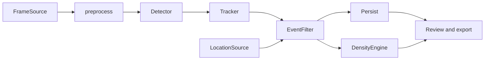
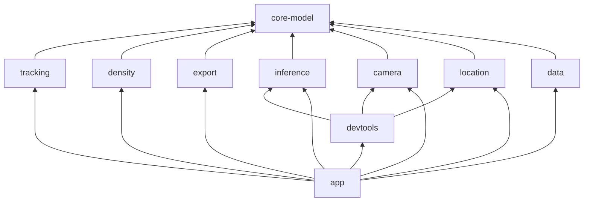
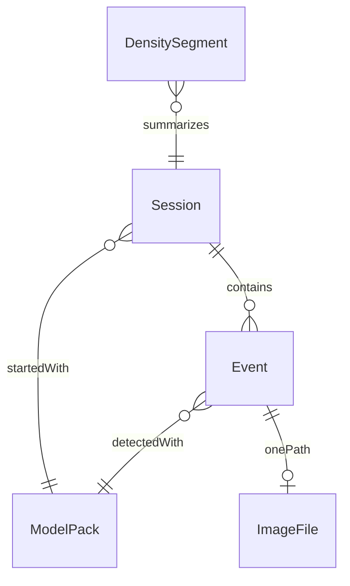
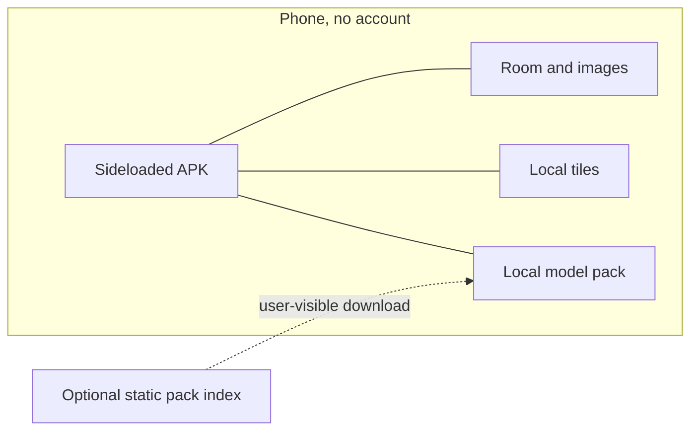

# Architecture Spine — Grape leaf detection

## Design Paradigm

Pipes and filters. One capture pipeline runs in order, and every external capability is a port on that pipe: `FrameSource`, preprocess, `Detector` / `InferenceBackend`, tracker, event filter, then persistence and density. `LocationSource` joins the pipe in parallel. `:app` is the only place that connects the ports.



## Invariants & Rules

### AD-1 — One capture pipeline `[ADOPTED]`

- **Binds:** all
- **Prevents:** a live path, a replay path, and a UI-owned tracker that each implement detection differently
- **Rule:** The foreground service in `:app` is the only composition root and the only capture pipeline. Video replay, GPX replay, and `FakeDetector` implement `FrameSource`, `LocationSource`, and `Detector`. `:devtools` selects those implementations and does not own a second pipeline. UI observes service state. It does not own tracks, run a detector, or write events.

### AD-2 — Module dependency direction `[ADOPTED]`

- **Binds:** all modules
- **Prevents:** Android APIs inside JVM-tested modules, and cycles between camera, inference, and location
- **Rule:** `:core-model` depends on nothing. `:tracking`, `:density`, and `:export` depend only on `:core-model` and import no Android APIs. `:inference`, `:camera`, `:location`, and `:data` depend on `:core-model` and not on each other. `:devtools` may depend on the port modules; they do not depend on it. `:app` depends on the other modules. Nothing depends on `:app`. Hilt is used only in Android modules.



### AD-3 — Shared contracts and the manifest `[ADOPTED]`

- **Binds:** core-model, inference, camera, location, data
- **Prevents:** hardcoded classes, a second box coordinate space, and a separate preprocess in the parity harness
- **Rule:** `Frame`, `Detection`, `NormalizedBox`, `GeoFix`, `Track`, `Event`, `Session`, `ModelPack`, and the config snapshot live in `:core-model`. `:camera` publishes upright frames: it applies sensor rotation once and disables stabilization that crops or warps. Downstream modules do not rotate again. `NormalizedBox` is `left`, `top`, `right`, `bottom`, each 0..1 of that upright frame after letterbox is removed, origin top-left, y downward. `classId` is the manifest id. The manifest is the only source of classes, colors, `inputFormat` (including `padValue` and letterbox), `minTrackFrames`, and per-class `minScore`. `:inference` owns the one preprocess used by live frames, still images, and the parity harness. `manifest.backend` and `manifest.outputFormat` select the runtime and the decoder. A decoder must not assume `yolo26-end2end` for every pack.

### AD-4 — Port shapes `[ADOPTED]`

- **Binds:** inference, camera, location, tracking, app
- **Prevents:** one epic streaming detections while another calls a per-frame function, and a tracker that invents boxes for dropped frames
- **Rule:** `Detector.detect` is synchronous and returns one frame's detections. An empty list is a gap. A track ends only when its configured max age is exceeded, not because a frame had no detections. `FrameSource.frames` and `LocationSource.fixes` are `Flow`s. Camera analysis keeps only the latest frame. The tracker does not synthesize detections.

### AD-5 — One writer for persisted state `[ADOPTED]`

- **Binds:** data, tracking, density, export, app
- **Prevents:** the tracker, the review UI, and export each writing rows or image files
- **Rule:** `:tracking` decides create, merge, and which in-memory JPEG is best. It does not write. Before the camera buffer is released, the foreground service encodes that upright frame to immutable JPEG bytes and a crop-thumbnail candidate and hands them to `:tracking`, which keeps the current best pair per open track. `:camera` retains nothing. `:data` writes the winning full frame and thumbnail once, when tracking emits track-ended. A merge discards the incoming bytes and does not update the stored image. `:data` applies that decision and does not run a second merge. `:export` is a pure function of values `:app` loaded from `:data`. It does not depend on `:data`. User feedback updates the existing event row through `:data`.

### AD-6 — What an event is `[ADOPTED]`

- **Binds:** tracking, data, export
- **Prevents:** an images table, a second image on merge, and events that lose the model identity
- **Rule:** A track that passes the effective `minTrackFrames` and per-class `minScore` creates one event, unless the same class within `mergeDistanceM` and `mergeWindowS` merges into an existing event. Those effective numbers come from the config snapshot, which is seeded from the manifest. Merge keeps that event's image and `trackId`. `classId` is the manifest id. `className` is copied onto the event at write time. Every event stores `packId` and `modelVersion`. The evidence is one full-frame JPEG and one crop thumbnail, one path each, and there is no images table. The files may be absent when the confidence setting skips them, or when cleanup deletes files and keeps the row.

### AD-7 — Canopy position `[ADOPTED]`

- **Binds:** location, data, export
- **Prevents:** the raw phone fix and the canopy point both being stored as the event position, and the session plot overwriting per-event polygon tags
- **Rule:** `PlatformLocationSource` uses `android.location.LocationManager` and is always available. A fused implementation is optional, is not a dependency of `:app`, and is never the only source. The mount offset is `mountSide` (`left` or `right`) plus `mountOffsetM` in meters. Stored `lat`/`lon` is the canopy point after that offset. EXIF GPS on the evidence frame matches that point. Fixes worse than the configured accuracy are flagged and excluded from the join and from distance. Accuracy, speed, and bearing from the fix used for the join are stored with the event. Distances are meters and speed is meters per second. `:data` stores imported plot polygons. `event.plotName` is set only by point-in-polygon over those polygons. `session.plotName` is the session label and is not copied onto events. Smoothing, mount offset, point-in-polygon, and the frame/fix join are pure functions in the JVM-testable part of `:location`. The join follows AD-13.

### AD-8 — Density is not severity `[ADOPTED]`

- **Binds:** density, app
- **Prevents:** counting frames as disease pressure, and using box area as the density count
- **Rule:** Density counts unique events per meter traveled. Meters are the summed distance between consecutive canopy points while speed is at or above `minSpeedMps`. A repeated event inside a segment does not raise the event count. Severity is the per-segment mean of detection-box area fraction, accumulated by `:density` during capture and stored on the segment row. `:density` returns segment values and does not write. `:data` is the only writer of those segment rows and of the accepted canopy samples. Review and export read those rows. They do not recompute density from frames. `segmentLengthM` and `minSpeedMps` are config. Segment collapse is not the event-identity merge in AD-6.

### AD-9 — Offline field use, no Play services on `:app` `[ADOPTED]`

- **Binds:** all
- **Prevents:** a sync client, a tile download during review, or a Play-services library becoming required in the field
- **Rule:** Capture, review, and export work with no network. There is no telemetry, account, or sync. The only network use is an optional, user-visible model-pack download on unmetered Wi-Fi, with progress and retry. SHA-256 is verified before a downloaded pack is used. A locally imported pack is always sufficient, and field use never waits on the network. `:app` does not depend on Play services, Firebase, ML Kit, Play Core, the Google Maps SDK, Play-services LiteRT, or fused location, including transitively. Background download and export use `androidx.work`, not the capture service. The review map is MapLibre drawing tiles already on the device. Navigate-to-spot is a geo intent. The APK is sideloadable. `minSdk` is 26.

### AD-10 — Packs, tiers, and heat `[ADOPTED]`

- **Binds:** inference, app
- **Prevents:** `:app` calling a runtime directly, and a first-run benchmark that must download media
- **Rule:** `InferenceBackend` is the only inference entry. Candidates are bundled LiteRT, NCNN, and ONNX Runtime Mobile. The post-spike benchmark picks the backend. The APK bundles at most a stand-in or the smallest tier. Other tiers are imported or optionally downloaded. The first-run benchmark selects the largest tier that holds the configured FPS without throttling, and the user can override it. If the smallest tier cannot, the app says so. Benchmark inputs are already on the device. On API 29 and above, thermal status may lower the inference rate or suggest a lighter tier. Below API 29 that adaptation does nothing. FPS targets, thermal steps, and tier choice are config.

### AD-11 — One config snapshot `[ADOPTED]`

- **Binds:** all
- **Prevents:** each module reading its own preferences, and a session that cannot name the settings that produced it
- **Rule:** `:app` is the only module that reads preferences. It loads one immutable config object from `:core-model` and passes it into every other module. The session stores that snapshot together with `packId`, `modelVersion`, device info, start, end, notes, and the session plot label. Cross-module keys are `maxTrackAge`, `minTrackFrames`, per-class `minScore`, `mergeDistanceM`, `mergeWindowS`, `minSpeedMps`, `segmentLengthM`, `mountSide`, `mountOffsetM`, `maxAccuracyM`, and `bestFrameWeights` (`confidence`, `boxArea`, `fullyInside`, `sharpness`). Values are deferred. Names are not. `padValue` and letterbox stay on the manifest and are not copied into this object.

### AD-12 — Stored identity and wall time `[ADOPTED]`

- **Binds:** data, export
- **Prevents:** Room and the exporters minting different ids or encoding timestamps differently
- **Rule:** `:data` mints one opaque stable id for each session and each event. Exporters copy those ids. Stored session and event instants are UTC epoch milliseconds. GeoJSON, CSV, and KML render events as points. GPX renders those points plus the track of accepted canopy samples from AD-8. Exporters render instants as ISO-8601 UTC. This wall clock is the human timestamp. The frame/fix join key is AD-13.

### AD-13 — Frame/fix join on elapsed realtime `[ADOPTED]`

- **Binds:** camera, location, data, devtools
- **Prevents:** one epic joining on UTC wall time and another on the camera clock, or attaching the latest fix
- **Rule:** `Detection.frameTimestampNs` is the camera sensor timestamp, on the elapsed-realtime nanosecond timebase (`SystemClock.elapsedRealtimeNanos()`). Every `GeoFix`, including GPX replay, carries `elapsedRealtimeNs` on that same timebase and `timeUtcMs` as UTC epoch milliseconds. One pure function in `:location` interpolates canopy position and the event's UTC instant along `elapsedRealtimeNs` only. No module joins on UTC, and no module attaches the latest fix.

## Consistency Conventions

| Concern | Convention |
| --- | --- |
| Naming | Ports are `FrameSource`, `LocationSource`, `Detector`, and `InferenceBackend`. Implementations are named by role: `CameraFrameSource`, `VideoReplayFrameSource`, `PlatformLocationSource`, `GpxReplayLocationSource`, `FakeDetector`. |
| Data and formats | WGS84. Stored instants are UTC epoch milliseconds. `frameTimestampNs` and `GeoFix.elapsedRealtimeNs` are elapsed-realtime nanoseconds. Ids are opaque strings. Export is GeoJSON, CSV, KML, and GPX (event points plus the accepted canopy track), plus a zip of images, shared with the platform share sheet. |
| State and cross-cutting | Persisted mutation goes through `:data` only. Port failures are exceptions. The foreground service decides whether a failure ends the session. No network logging. No auth. |
| Build | Versions are pinned in one version catalog. Dependency review rejects Play-services artifacts on the `:app` classpath. JVM tests cover tracker, event filter, best-frame score, merge, density, polygon tagging, and exporters. |

## Stack

Seed, verified 2026-11-08. The version catalog owns these once the build exists.

| Name | Version |
| --- | --- |
| Kotlin | 2.4.21 |
| Android Gradle Plugin | 9.5.0 |
| compileSdk / targetSdk | 37 |
| minSdk | 26 |
| Jetpack Compose BOM | 2026.09.00 |
| CameraX | 1.6.2 |
| Gradle | 9.6.0 |
| Room (`androidx.room3`) | 3.0.3 |
| WorkManager (`androidx.work`) | 2.12.0 |
| Hilt | 2.60.1 |
| kotlinx-coroutines | 1.11.0 |
| MapLibre Android SDK | 13.7.1 |

## Structural Seed

```text
settings.gradle.kts
gradle/libs.versions.toml
core-model/     # Frame, Detection, GeoFix, Track, Event, Session, ModelPack, config snapshot
inference/      # Detector, InferenceBackend, the one preprocess, FakeDetector, bundled runtimes
camera/         # FrameSource, CameraX plus Camera2 interop, video replay
location/       # LocationSource, LocationManager, GPX replay, join, smoothing, polygons
tracking/       # tracker, gap tolerance, event filter, best-frame score, merge
density/        # events per meter, severity proxy, segment alerts
data/           # Room, repositories, image files
export/         # GeoJSON, CSV, KML/GPX, zip bytes
devtools/       # debug HUD, parity-harness hooks, replay selection
app/            # Compose, Hilt, foreground service, pipeline, share sheet, WorkManager
```





There is no app backend. Field use does not need the pack host. Tiles are a local store owned by the review screen.

## Capability → Architecture Map

| Capability | Lives in | Governed by |
| --- | --- | --- |
| Capture pipeline and tractor mode | app foreground service | AD-1, AD-4, AD-11 |
| Camera, exposure, focus, video replay | camera | AD-1, AD-3, AD-4 |
| Detector, preprocess, parity | inference | AD-3, AD-4, AD-10 |
| Tracker, merge, best frame | tracking | AD-4, AD-5, AD-6 |
| GPS, offset, plots, frame join | location | AD-7, AD-12, AD-13 |
| Sessions, images, feedback | data | AD-5, AD-6, AD-12 |
| Density, severity, live alert | density | AD-8 |
| Review map, list, navigate | app | AD-8, AD-9 |
| Export and share | export, app | AD-5, AD-8, AD-9, AD-12 |
| Tiers, benchmark, thermal, pack download | app, inference | AD-9, AD-10, AD-11 |
| Debug HUD and replay selection | devtools | AD-1 |

## Deferred

- Inference backend winner, chosen by the post-spike benchmark among the bundled candidates in AD-10.
- Host for `index.json`. The app depends on the index fields (packs, versions, URLs, SHA-256, sizes) and a configured URL, not on a vendor.
- Which tiers above the smallest are listed in the index. Import and optional download both exist.
- Benchmark media, still images or a short bundled clip, as long as it is on the device and runs long enough to show throttling.
- Numeric thresholds, weights, and segment length. They are config, tuned on the phone.
- Tile archive format. Review only reads a local store.
- Navigation library, chosen once inside `:app`. No other module navigates.
- Whether a release build omits `:devtools`.
- Real-model quantization, input resolution, and per-class threshold numbers. They arrive as a pack, at the model swap.
- Segmentation-based severity and external RTK. Later, behind `Detector` output and `LocationSource`.
